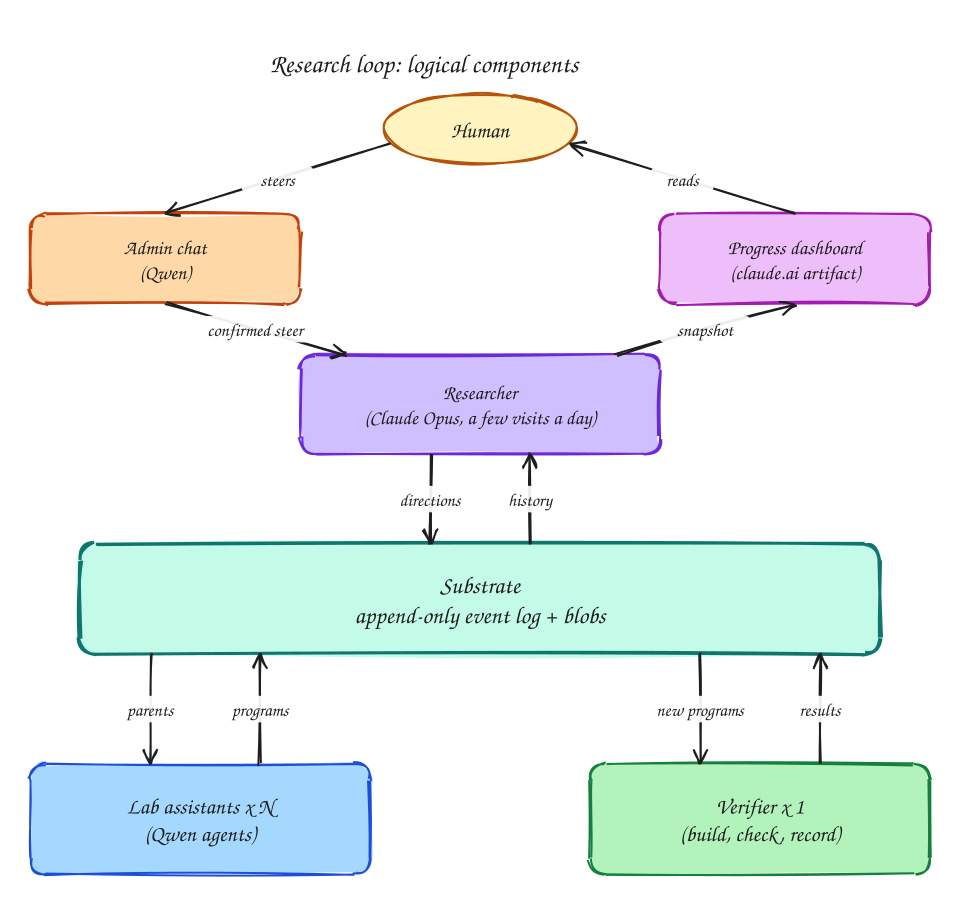

# kaggle-quantum-challenge

An auto-research loop for the Kaggle competition *Google Quantum AI: Verifiable Quantum Circuit
Compilation*. A scarce, strong model sets direction, many free local-model agents run experiments
around the clock, and an exact local verifier decides which attempts were good.

The first target is the `invsqrt` task: submit one circuit that computes an inverse square root,
and the score is its cost, Q x (Toffolis + T/4), lower is better. The goal is to beat the best
public result (15.2x the reference, cost 136,796, Q = 82) and push toward the claimed top of the
leaderboard (about 20x). The human submits to Kaggle; the loop never does.

## The system at a glance

Five logical parts, each with one job:

| Part | Job |
|---|---|
| **Researcher** | A strong model (Claude Opus) that visits a few times a day, reads what happened, and sets direction: which ideas to pursue, what has been learned. |
| **Lab assistants** | Many cheap agents (Qwen) that run experiments nonstop, following the researcher's directions: each one edits a circuit generator and submits it. |
| **Verifier** | Exact, local scoring of every submission against the competition's own checker. Nothing counts until it says so. |
| **Substrate** | The permanent record: an append-only, validated event log plus stored programs and circuits. Every other part reads and writes only through it. |
| **Human** | Watches a progress dashboard, steers through an admin chat, and submits to Kaggle. |



The researcher directs the lab assistants through the substrate, the verifier judges what they submit, and the human steers the researcher and reads its dashboard.

The parts never call each other: they coordinate only by reading and writing the substrate, so
there is no central orchestrator and each part can be stopped or replaced independently.

### Islands and parent selection

Every candidate solution is a **program**: generator code that builds a circuit. Programs belong to
**islands**, each island pursuing one idea (one line of attack) and carrying instructions written by
the researcher for the assistants. Islands exist only in the loop, derived from events; the substrate knows nothing about
them. A lab assistant picks an island by weight, then a parent within it, favouring good programs
that few others are already working from. There is no central assignment: every announcement lowers
the parent's weight for the next assistant that reads the log, so concurrent assistants spread out
on their own. The researcher drives island weights, migration, restarts from a chosen program, and
retirement.

### Researcher

The researcher is the only part that spends the scarce strong-model budget, so it runs a few times
a day and never does individual experiments. Each visit it reads a digest prepared by code (how each
island is trending, past directions and how they turned out, recent failure patterns, budget state,
new human instructions) and records its decisions as events:

- a **direction** per decision, with the reason and a checkable prediction;
- the **island changes** that carry the direction out;
- **lessons** (what works, what does not, open questions) that every lab assistant reads;
- **questions** for the human.

Predictions are marked met or missed by code from later events, not by the model. A budget gate
decides whether a visit may happen at all.

### Lab assistants

Lab assistants are many cheap agents working in parallel, each repeating one cycle: choose an
island and a parent program in it, announce what it is about to try, read a brief (the parent
program, the island's instructions, the lessons so far), then make one small, targeted change to the
generator and submit it as a new program. Every attempt is recorded, whether it changes anything or
not, along with what it cost. An assistant's behaviour (prompt, tools, limits) is a versioned role,
and every event it writes names that version, so results are attributable to the behaviour that
produced them.

A **program** is a bundle holding a circuit generator; building it yields a circuit, and a
**candidate** is one such circuit. One program has many candidates. The first program is Google's
reference generator, and further islands are seeded from the strongest public generators, one
approach per island.

### Verifier

The verifier is plain code with no model. It scores every new program using the competition's own
checker, in tiers, so the expensive check runs only on candidates that might matter:

- **Build** the generator in isolation; a program that fails to build is rejected.
- **Duplicate rejection**: a circuit identical to one already measured is rejected, since
  re-measuring buys nothing.
- **Full-domain sweep**: run the circuit once on every input. This catches circuits that are wrong
  anywhere in the domain and yields a cost estimate.
- **Gate**: reject as "not better" only if the estimate is more than 5% worse than the island's
  best; a random 5% of those rejections go to the full check anyway, as an audit of the gate.
- **Full check**: many shots per input, one salt at a time, stopping at the first failing salt.

Every outcome is recorded as an event, and "not better" means not fully verified, not dropped.

### Substrate

**Purpose.** The substrate is the system's permanent memory: an append-only record of everything
that happened (programs written, circuits measured, decisions taken, resources spent) plus the
files those facts refer to. Every other part reads and writes only through it, and the research
loop itself is disposable: it can be rewritten, or replaced by a different design, and pick up from
the same history.

**Design.** It is event-sourced. Each fact is an immutable event; current state (the best circuit
so far, an island's members, a program's lineage) is computed from events when asked, never stored
and updated. An event is an *envelope* that every event shares (identity, time, type, the thing it
is about, who wrote it, what prompted it) wrapping a type-specific *payload*.

**Versioning.** Event shapes evolve, so the design makes change safe rather than forbidding it:

- The envelope and each event type carry independent version numbers, so one type can change
  without touching any other.
- Every event type has a JSON Schema per version, and every write is validated against it; an
  invalid or unknown event is rejected before anything is stored.
- Nothing already written is ever rewritten. Readers convert old payloads to the current shape on
  read (upcasting) and refuse versions newer than they understand.
- A field whose meaning changes gets a new name, so old and new data can never be confused.

The contract is [`substrate/SPEC.md`](substrate/SPEC.md); every event type and its fields are in
[`substrate/schema/`](substrate/schema/).

### Admin chat

A Qwen-backed agent with read-only access to the substrate. It answers status questions and
explanations itself. Steering and ideas need the researcher, so it shows the current Claude budget
and asks the human to confirm; once confirmed, the message is recorded as an instruction and the
researcher visits immediately if the budget allows, or at its next scheduled visit otherwise. The
strong model is used only after that explicit confirmation.

### Progress dashboard

A private page the researcher publishes, laid out as in
[`docs/superpowers/specs/assets/2026-11-11-progress-view-mockup.html`](docs/superpowers/specs/assets/2026-11-11-progress-view-mockup.html)
(the numbers in the mockup are invented). It shows where the score stands against the public best
and the claimed top, best cost over time marked with each researcher direction, system health
(budget, assistant hit rate, verifier queue), the island table, the decision log with predictions
and outcomes, and open questions. It refreshes with each researcher visit rather than live.

## Why this shape

The competition's scoring function runs locally, exactly, and for free. So the scarce input is not
the correctness of any single attempt but the volume of attempts, and the loop routes each kind of
work to the cheapest resource that can do it.

| Resource | Cost | Used for |
|---|---|---|
| Local Qwen on a DGX Spark | free | lab assistants: running experiments that follow the researcher's directions |
| Local CPU (16-core NixOS VM) | free | building circuits and verifying them exactly |
| Claude Opus on a $20 Pro plan | scarce: a 5-hour window plus a weekly cap | a few decisions a day: which ideas to pursue, what has been learned |
| The human | scarcest | steering, and submitting to Kaggle |

Consequences that shape the research loop:

- **Volume beats precision.** Scoring is exact and free, so a cheap model's edit only has to be
  right occasionally: the verifier finds the good ones. Nothing counts until it is verified.
- **Strong-model time is the scarcest input.** Opus runs a few times a day, so it never does
  individual experiments. It reads a prepared summary and decides direction: which lines of attack
  get effort, what has been learned, what to try next.
- **Many assistants must not duplicate each other.** Work is not assigned one by one; programs are
  grouped into islands, and parent selection favours good programs that few others are already
  working from.
- **Full verification is expensive, so it is spent on contenders.** Cheap checks stop most bad
  attempts in seconds; the full multi-salt check runs only on candidates that might beat their
  island.

## Deployment and security

### Storage

Events live in a single SQLite database (WAL mode) whose commit-order sequence number (`seq`) is
the cursor every consumer resumes from; triggers block updates and deletes. Programs and circuits
are stored as files named by their SHA-256 hash, compressed with zstd. The query layer (best
candidates, lineage, budget totals) is a set of read-only projections over the events.

### The substrate service

The substrate runs as `substrated`, the only process allowed to open the database and files. Loop
components call it over a local Unix socket. It identifies each caller by its Unix user
(`SO_PEERCRED`) rather than trusting what the caller claims, and stamps the caller's role on every
event itself. A policy file (`loop/policy.json`) limits each role to the event types it needs:

| Role | May write | May not |
|---|---|---|
| Lab assistant worker | announcements, program submissions, its own spend | measurements |
| Verifier | measurements, rejections, verifier spend | program submissions |
| Researcher | directions, island changes, lessons, questions, quota observations | measurements |

Clients retry with backoff, so `substrated` can be restarted without losing writes.

### Sandboxing

Models write the code that runs, so both places where model output executes are confined with
bubblewrap (`bwrap`):

- **pi jobs** see `/nix/store` and the repo read-only, can write only their own job directory under
  the work root, and get a private `/tmp` and `HOME`. The network stays reachable (the model
  endpoint), but `/run/substrate` is not mounted, so an agent cannot reach the socket. Its only
  route to the log is the worker process that supervises it.
- **`gen.py` builds** run the same way, except the only writable path is the build directory and
  the network is unshared.

On Linux, `bwrap` is required and startup fails if it is missing, rather than silently running
unconfined. On macOS, where it does not exist, both run unsandboxed with a logged warning so that
development and tests still work.

### Agents

Every agent runs in the pi coding-agent harness, headless, one fresh process per job. Lab assistants
use a self-hosted Qwen endpoint with a read/edit/search tool allowlist and a capped output budget;
their brief is ordered stable-first so the model server's prefix cache covers it. The researcher
and its digest use Claude Opus through pi-claude-bridge, which drives Claude Code through the
official Agent SDK on a Claude Pro login. The plan is used only by the loop, and the rule is: at
most 80% of either Pro plan limit; the last 20% is a backup. Plan usage arrives only with a
response, so after every Claude run the researcher service records the observed usage, and before a
visit it reads the latest observation: a visit is allowed only if both the five-hour and weekly
figures are under the limit, or the observation is past its reset time. Workers back off
exponentially after repeated failures, so an unreachable endpoint never causes a hot loop.

### Processes

Each part of the loop is an independent systemd service: one `substrated`, N lab assistant workers,
exactly one verifier, and the researcher service. There is no central orchestrator; services
coordinate only through the substrate, and each finishes its current job before stopping, so any
one can be restarted alone. Exactly one verifier runs because nothing claims a program before
verifying it, so a second instance would score everything twice.

### Nix and releases

A Nix flake provides the toolchain, and a NixOS module defines the services and the per-role Unix
users. The loop code runs from a git checkout, so a code update needs a pull and a restart, not a
rebuild. See [`docs/deploy.md`](docs/deploy.md).

## Repository layout

| Path | Contents |
|---|---|
| `substrate/` | The event log: `cli.py` (the in-process API), `server.py` (`substrated`), `_store.py`, `_blobs.py`, `_projections.py`, `_schemas.py`, `upcasters.py`, `types.py`, plus `SPEC.md` |
| `substrate/schema/`, `substrate/fixtures/` | One JSON Schema and one sample payload per event type-version; never deleted |
| `loop/` | The loop: `worker.py`, `verifier.py`, `verify.py`, `pool.py`, `seed.py`, `pi_runner.py`, `programs.py`, `policy.py`, `policy.json`, `config.py`, `state.py` |
| `roles/lab_assistant/v1/` | Versioned lab assistant role: system prompt, task template, island instructions, `role.json` |
| `verifiers/` | Vendored competition verifier and reference generator (Apache-2.0) |
| `tests/` | `substrate/` and `loop/` tests; `fakes/openai_server.py` is a fake model endpoint for smoke tests |
| `docs/diagrams/` | The system diagram |
| `flake.nix`, `nix/module.nix` | Dev shell and the `services.research-loop` NixOS module |
| `nix/vm-test/` | A NixOS VM configuration used to prove the module end to end |
| `docs/` | Design spec, implementation plans, deploy guide |

Out of scope: the other tasks (`dqi`, `dfthcsos`), automatic Kaggle submission, multi-machine
operation, and blob garbage collection.

## Getting started

Development needs Python 3.12 and [uv](https://docs.astral.sh/uv/).

```sh
uv sync
uv run pytest
```

Tests that need the `pi` CLI are marked `pi` and skip when it is absent. To run them you need
Linux and the Nix dev shell, which provides Python, uv, Node, and pi:

```sh
nix develop -c uv run pytest -m pi
```

### Running locally

All commands take a data root, which holds `events.sqlite` and `blobs/`. Here they open it
in-process (`--root`, an alias for `--substrate <directory>`); in a deployment the same entry
points use `--substrate unix:/run/substrate/api.sock`. The worker needs `pi` (use `nix develop`)
and an OpenAI-compatible endpoint.

```sh
ROOT=./var/substrate

# 1. Create the log, register schemas, seed the reference generator
uv run python -m loop.seed --root $ROOT

# 2. The verifier (exactly one)
uv run python -m loop.verifier --root $ROOT --state ./var/verifier.state \
    --workdir ./var/verifier-work --salts 1 2 3 4 --max-workers 8

# 3. One or more lab assistants; --api-key-env names an environment variable holding the key
export QWEN_API_KEY=none        # placeholder for a keyless endpoint
uv run python -m loop.worker --root $ROOT --id 1 \
    --base-url http://localhost:8000/v1 --model <model-id> \
    --api-key-env QWEN_API_KEY --workroot ./var/work/worker-1 \
    --context-window 32768 --max-tokens 4096
```

Run the verifier and each worker in its own terminal. `SIGTERM` makes each finish its current job
and exit. `loop/worker.py` and `loop/verifier.py` document the remaining flags (`--poll`,
`--role-dir`).

Inspect results through the substrate CLI. Subcommands are `init`, `append`, `put-blob`,
`get-blob`, `history`, `since`, `frontier`, `lineage`, `budget` and `export`:

```sh
uv run python -m substrate.cli --root $ROOT frontier invsqrt
uv run python -m substrate.cli --root $ROOT since --types candidate.rejected --limit 20
uv run python -m substrate.cli --root $ROOT budget qwen --window 7d
uv run python -m substrate.cli --root $ROOT export events.jsonl
```

### Deploying

The devbox imports this repo's NixOS module, which defines the checkout, `substrated`, seed,
verifier, and worker units under one `research-loop.target`, along with the per-role Unix users.
Follow [`docs/deploy.md`](docs/deploy.md) for the flake input, the `services.research-loop`
options, and the operating commands.

## Further reading

- [Research loop design](docs/superpowers/specs/2026-11-11-research-loop-design.md): intent, goals,
  non-goals, constraints, roles, islands, the researcher, versioning.
- [Substrate contract](substrate/SPEC.md): envelope, event types, storage, API, invariants.
- Plans: [substrate](docs/superpowers/plans/2026-11-11-substrate.md),
  [first loop](docs/superpowers/plans/2026-11-11-first-loop.md),
  [substrated, sandbox and sweep tier](docs/superpowers/plans/2026-11-11-substrated-sandbox.md).
- [Deploy guide](docs/deploy.md).
